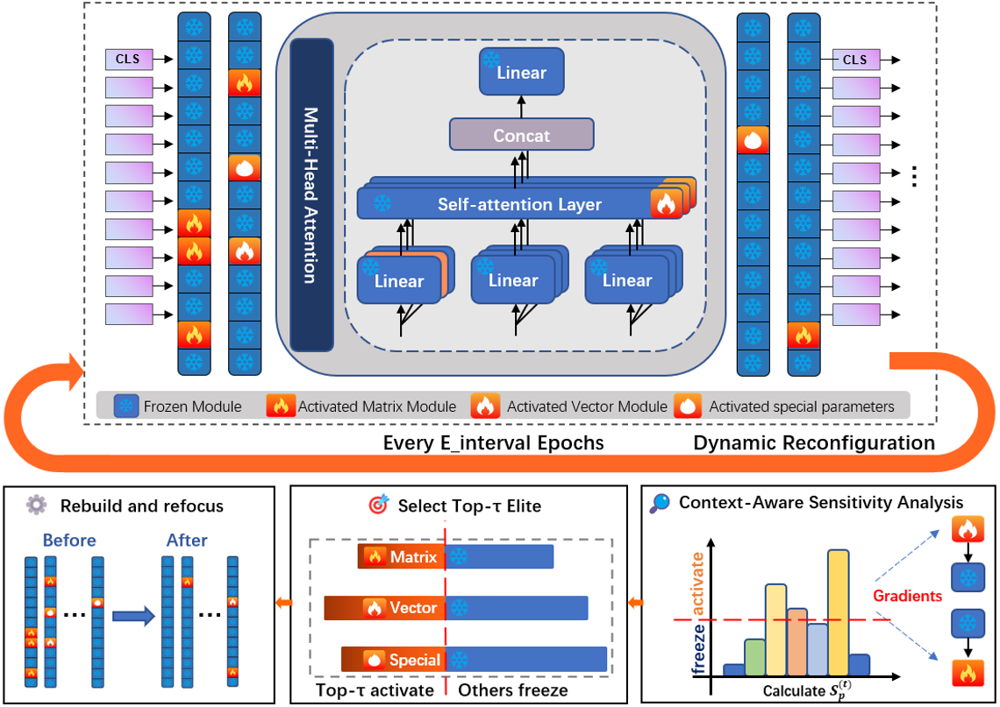

# DAF ViT Table-1 Training Code

This repository contains the source code and launchers for the DAF ViT-B/16
training workflow. Model weights, datasets, logs, and generated checkpoints are
external: place the first two under the paths below before running a launcher.



## Repository layout

```text
.
├── src/daf_vit/          # training, data loading, LoRA, and DAF implementation
├── scripts/              # preparation, training, and summary launchers
├── tests/                # unit and release-contract tests
├── data/                 # external datasets (README only in the source release)
├── checkpoints/          # external ViT checkpoint (README only in the release)
└── docs/                 # detailed setup and reproduction instructions
```

## Environment setup

Python 3.10 is recommended. A normal installation with Conda is:

```bash
conda create -n daf python=3.10
conda activate daf
python -m pip install --upgrade pip
python -m pip install torch torchvision --index-url https://download.pytorch.org/whl/cu128
python -m pip install -r requirements.txt
python -m pip install -e . --no-deps
```

For the dependency versions used to validate this release, use Python 3.10.20
and install the CUDA-enabled PyTorch wheels separately from the remaining
locked direct dependencies:

```bash
conda create -n daf-repro python=3.10.20
conda activate daf-repro
python -m pip install --upgrade pip
python -m pip install torch==2.11.0+cu128 torchvision==0.26.0+cu128 --index-url https://download.pytorch.org/whl/cu128
python -m pip install -r requirements-repro.txt
python -m pip install -e . --no-deps
```

That validated stack uses the CUDA 12.8 PyTorch runtime. The NVIDIA driver on
the host must support that runtime. The complete direct-dependency list is in
`requirements-repro.txt`; `requirements.txt` remains the less restrictive
installation option.

The validated direct versions are Python 3.10.20, torch 2.11.0+cu128,
torchvision 0.26.0+cu128, timm 1.0.28, PyYAML 6.0.3, tqdm 4.69.0, pytest 9.1.1,
datasets 5.0.0, huggingface-hub 1.24.0, and numpy 1.26.4.

Optional data-preparation utilities are only needed when the required dataset
files have not already been prepared. The main DAF training commands use the
`daf` environment. See `docs/DATA_AND_WEIGHTS.md` for optional preparation
steps and the required file layout.

For optional data-preparation work, use a separate Python 3.10 environment
instead of adding TensorFlow and TensorFlow Addons to the training environment:

```bash
conda create -n daf-spt python=3.10
conda activate daf-spt
python -m pip install --upgrade pip
python -m pip install -r requirements-spt.txt
```

The Hugging Face helper prepares the other 16 VTAB tasks; it is not a substitute
for the two SPT/TFDS CLEVR task trees.

Run relative commands from the repository root. For example, run the tests as:

```bash
python -m pytest tests -q
```

## External files

The default paths are:

```text
checkpoints/ViT-B_16.npz
data/cifar-100-python/
data/vtab-1k/<task>/
```

The checkpoint and dataset trees are not included. See
[`docs/DATA_AND_WEIGHTS.md`](docs/DATA_AND_WEIGHTS.md) for the complete task and
split-file layout. The launchers accept absolute external paths too, through
`CHECKPOINT` and `DATA_ROOT`. `CLEVR_DATA_ROOT` is an optional override when
the two manifest-checked CLEVR task directories live under a different common
root.

## VTAB-1k dataset

Prepare the VTAB-1k data with:

```bash
bash scripts/prepare_vtab1k_hf.sh
```

The script automatically downloads and prepares the supported VTAB-1k tasks
from Hugging Face.

## Check first, then run

The relative script commands below must also be run from the repository root.
The launcher's `--check` mode validates Python, the GPU list, checkpoint,
CIFAR-100 directory, every required VTAB list file, and the six CLEVR split-list
checksums; it does not start training:

```bash
bash scripts/reproduce_table1_vit_b16_npz_test_best.sh --check
```

The script itself resolves project files from its installed location. To call
it from any working directory, use an absolute script path:

```bash
bash /path/to/DAFgit/scripts/reproduce_table1_vit_b16_npz_test_best.sh --check
```

Run the complete workflow on one GPU:

```bash
GPU_LIST=0 bash scripts/reproduce_table1_vit_b16_npz_test_best.sh
```

Or distribute concurrent tasks over several GPUs:

```bash
GPU_LIST=0,1,2,3 bash scripts/reproduce_table1_vit_b16_npz_test_best.sh
```

For a smaller end-to-end smoke run after the corresponding data are installed:

```bash
GPU_LIST=0 bash scripts/train_cifar100_daf_vit_b16_npz.sh --check
GPU_LIST=0 OUTPUT_DIR="$PWD/outputs/smoke-cifar100" bash scripts/train_cifar100_daf_vit_b16_npz.sh
```

The main launcher's configurable variables are `PYTHON`, `DATA_ROOT`,
`CLEVR_DATA_ROOT`, `CHECKPOINT`, `OUTPUT_ROOT`, `LOG_ROOT`, `GPU_LIST`, `NUM_WORKERS`,
`BATCH_SIZE`, `SEED`, `MODEL`, `EVAL_INTERVAL`, and `SAVE_EVERY`. Exact defaults,
override examples, and run-state handling are documented in
[`docs/REPRODUCE_TABLE1.md`](docs/REPRODUCE_TABLE1.md).

By default, per-task run directories are written below
`outputs/reproduce_table1_vit_b16_npz_test_best/` and text logs below
`logs/reproduce_table1_vit_b16_npz_test_best/`. These are run artifacts. A
successfully finished task contains a `.complete` marker. An interrupted or
failed task deliberately has no marker, and the launcher refuses to overwrite
its partial directory or log. Use new output/log roots or archive the exact
partial artifacts before retrying.
The `.daf-launch.lock` directories prevent two launchers from owning the same
roots; never remove one while its launcher is active.

Using the same software versions, inputs, configuration, and `SEED` reduces
run-to-run differences. It does not guarantee bitwise-identical execution:
GPU kernels, parallel data loading, drivers, and library implementations can
still introduce nondeterminism.
